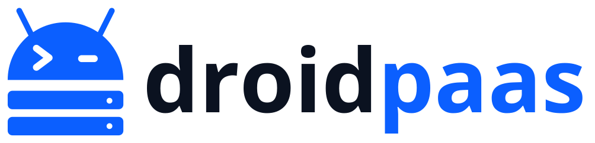

<p align="center">
  <picture>
    <source media="(prefers-color-scheme: dark)" srcset="assets/logo/wordmark-dark.svg">
    
  </picture>
</p>

**Transforme um celular Android antigo no seu próprio servidor de aplicações.**
Você dá `git push` e o app entra no ar, com domínio próprio e um painel web para acompanhar tudo. Sem root, sem Docker, sem nuvem paga: roda direto no [Termux](https://termux.dev).

Pense num "Heroku/Dokku de bolso": um programa que usa menos de 20 MB de RAM e cuida de build, deploy, reinício automático, logs e domínios dos seus projetos.

> Testado de verdade num Samsung Galaxy M22 (4 GB de RAM, Android 13): 72 horas seguidas sem nenhuma queda e painel respondendo em cerca de 40 ms. Os números e como foram medidos estão em [docs/fase-2](docs/fase-2/README.md) e [docs/fase-3](docs/fase-3/README.md).

## O que você ganha

- **Deploy por `git push`** (SSH ou HTTP): o build roda no aparelho e o log aparece no seu terminal.
- **Node, Python, Go e sites estáticos** detectados sozinhos (ou configure com um `Procfile`/`droidpaas.toml`).
- **Se um deploy falhar, nada quebra:** a versão anterior continua no ar, e dá para voltar a ela com um clique (rollback).
- **Painel web** (celular e computador, tema claro/escuro): apps, deploys com log ao vivo, variáveis de ambiente (segredos mascarados), logs em tempo real, domínios, chaves SSH e o estado do aparelho (bateria, temperatura, RAM, disco).
- **Seus apps na internet** pelo túnel da Cloudflare, sem abrir portas no roteador.
- **Se um app cai, ele volta:** reinício automático, com freio contra loops de falha.
- **Uma CLI** (`droid`) para tudo o que o painel faz.

## Antes de começar

Você precisa de:

- Um celular Android 11 ou mais novo com o **[Termux](https://f-droid.org/packages/com.termux/)** instalado **pelo F-Droid ou pelo GitHub** (a versão da Play Store não funciona).
- Wi-Fi e, de preferência, o aparelho **na tomada**.
- Opcional, mas recomendado: **Termux:API** (para o painel mostrar bateria e temperatura) e **Termux:Boot** (para subir sozinho depois de reiniciar).

O Android costuma "matar" processos em segundo plano. Para o servidor ficar de pé 24 h, siga o checklist de [docs/operacao.md §7](docs/operacao.md) (isentar o Termux da otimização de bateria e desativar o *phantom process killer*). Leva uns 5 minutos e faz toda a diferença.

## Instalação (5 minutos)

No Termux:

**1. Instale as dependências**

```bash
pkg update && pkg install -y git golang openssh runit termux-services caddy
```

**2. Baixe e instale o DroidPaaS**

```bash
git clone https://github.com/fabiodejesusfferreira/droidpaas.git
cd droidpaas
sh scripts/install.sh
```

O instalador compila o programa no próprio aparelho (leva alguns minutos), pede um **usuário e uma senha de administrador** (mínimo 12 caracteres) e mostra, **uma única vez**, o seu primeiro token de API. Guarde os dois num gerenciador de senhas.

**3. Reabra o Termux** (feche e abra de novo) para o gerenciador de serviços subir. Depois confira:

```bash
droid login --url http://127.0.0.1:8090 --token COLE_O_TOKEN_AQUI
droid status
```

Você deve ver `droidd`, `dp-caddy` e `sshd` como `run`.

**4. Abra o painel** no navegador do próprio celular: `http://127.0.0.1:8090`, e entre com o usuário e a senha que você criou.
Para abrir do computador, faça um túnel SSH (`ssh -N -L 8090:127.0.0.1:8090 -p 8022 USUARIO@IP_DO_CELULAR`) e acesse `http://127.0.0.1:8090`. O usuário do Termux aparece com o comando `whoami`.

## Publicando seu primeiro app

Crie o app pelo painel (**Novo app**) ou pela CLI, cadastre sua chave SSH e envie o código:

```bash
droid apps create meu-app                         # 1. cria o app
droid keys add ~/.ssh/id_ed25519.pub              # 2. libera sua chave para o git push
cd meu-projeto                                    # um repositório git com pelo menos um commit
git remote add droid ssh://$(whoami)@127.0.0.1:8022/meu-app.git
git push droid main                               # 3. build + deploy, ao vivo no terminal
```

Esse exemplo é para enviar de dentro do próprio celular. Se o `git push` for de **outro computador**, troque `127.0.0.1` pelo IP do celular, o usuário pelo do Termux e cadastre a chave pública desse computador. A página **Publicar** do app, no painel, mostra o passo a passo.

Seu app só precisa **escutar em `HOST` e `PORT`** (variáveis de ambiente) e ter um jeito de iniciar: `package.json` com `start` (Node), `Procfile` com `web:` (Python), `go.mod` (Go) ou `index.html` (site estático). Exemplo mínimo em Node:

```js
require("http").createServer((req, res) => res.end("Olá!\n"))
  .listen(process.env.PORT, process.env.HOST);
```

## Colocando na internet (opcional)

Com um domínio na Cloudflare você publica os apps em `meu-app.seudominio.com` e o painel em `painel.seudominio.com`, protegido por login (Cloudflare Access), sem abrir nenhuma porta no roteador. O passo a passo, já testado, está em [docs/operacao.md §4](docs/operacao.md).

## O que é bom saber (limites honestos)

- **Não há isolamento entre os apps:** todos rodam com o mesmo usuário do Termux. Hospede só código em que você confia.
- É um servidor **pequeno**: ótimo para sites, APIs leves, bots e projetos pessoais; não é para cargas pesadas.
- Dependências nativas de npm/pip podem ser lentas ou falhar no Android.
- Faça backup de vez em quando: `droid backup --out backup.tar.gz --with-key`. Guarde o arquivo como uma senha: sem a chave, as variáveis cifradas não podem ser recuperadas.

## Comandos úteis

```bash
droid apps                      # lista os apps e o estado
droid logs meu-app -f           # logs ao vivo
droid deploys meu-app           # histórico de deploys
droid rollback meu-app          # volta à versão anterior
droid env meu-app set CHAVE=valor --secret --restart
droid domains meu-app add meu-app.seudominio.com
droid settings                  # configurações globais
droid status                    # saúde do servidor
```

Guia completo (portas, túnel, backup, atualização, problemas comuns): [docs/operacao.md](docs/operacao.md).

## Como o projeto foi construído

O desenvolvimento foi dividido em fases, cada uma com testes e medições no aparelho real:

| Fase | O que entrega | Status |
|---|---|---|
| 0 | Esqueleto do repositório | ☑ |
| 1 | Prova de conceito no aparelho (runit, Caddy, git por SSH, túnel) | ☑ [relatório](docs/fase-1/README.md) |
| 2 | Servidor `droidd`, CLI `droid` e API | ☑ [soak de 72 h](docs/fase-2/README.md) |
| 3 | Painel web | ☑ [resultados](docs/fase-3/README.md) |

A especificação técnica completa está em [docs/tsd.md](docs/tsd.md).

## Para desenvolvedores

Requer Go 1.26 ou mais novo.

```bash
make test    # go test ./... no PC (usa runit, proxy e dispositivo falsos)
make build   # binários em bin/
make e2e     # no Termux: suítes de test/e2e com runit, Caddy, sshd e git reais, num sandbox isolado
```

Para ver o painel com dados fictícios, sem celular: `go test -tags demo -run TestDemo -timeout 0 ./internal/web` e abra `http://127.0.0.1:18999` (usuário `admin`, senha `senha-de-teste-123`).

```
cmd/droidd, cmd/droid   o servidor (daemon) e a CLI
internal/               pacotes (cada dependência do ambiente fica atrás de uma interface)
web/                    templates e assets do painel (embutidos no binário)
migrations/             SQL versionado
scripts/                instalador e scripts de medição
test/                   fixtures e testes de ponta a ponta para o aparelho
docs/                   operação, TSD e um README por fase
```

## Licença

[MIT](LICENSE).
